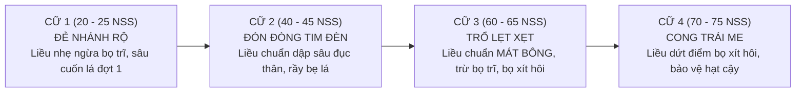

# CẨM NANG 4 CỮ PHUN THUỐC SÂU & ĐỊNH MỨC DIỆN TÍCH THỰC CHIẾN
## SẢN PHẨM: THUỐC TRỪ SÂU NETO PLUS 2X MORE POWER (BIFENUSAVB 10EW)
**Đơn vị phân phối:** CÔNG TY CỔ PHẦN PHÂN BÓN MIỀN NAM (PHÂN BÓN MN)  
**Hotline Kỹ thuật:** `039.899.2419` | **Quy cách:** Chai 1 Lít (Dạng sữa EW mát cây)

---

## PHẦN 1: MA TRẬN 4 CỮ THUỐC SÂU SINH TỬ TRONG 1 VỤ LÚA MIỀN TÂY

Tập quán canh tác thực tế của nông dân ĐBSCL không chờ sâu phá hoại mới xịt mà đi **3 đến 4 cữ đón đầu** trong 1 vụ:

### BẢNG CHI TIẾT 4 CỮ NÔNG HỌC & LIỀU PHA CHUẨN:

| Cữ xịt & Tuổi lúa | Đối tượng dịch hại mục tiêu | Nỗi lo lớn nhất của Nông dân | Phác đồ kỹ thuật Neto Plus (Dạng Sữa 10EW) |
| :--- | :--- | :--- | :--- |
| **CỮ 1: ĐẺ NHÁNH RỘ (20 – 25 ngày sau sạ)** | • Bọ trĩ (bù lạch) làm tóp đọt lá mạ. • Sâu cuốn lá lứa 1 (bướm rộ sau mưa). • Sâu phao cắn đọt ngang mặt nước. | Sợ thuốc sâu nhũ dầu nóng làm **chùn đọt lúa non, khựng cây**, đẻ nhánh kém. | **Liều nhẹ:** Pha **$30 - 35\text{ ml}$ / bình 25L** (1 chai pha được 28–33 bình). Dạng sữa cực mát, bảo vệ cơi chồi hữu hiệu mởn mập. |
| **CỮ 2: ĐÓN ĐÒNG TIM ĐÈN (40 – 45 ngày sau sạ)** | • Sâu đục thân đẻ trứng (nguy cơ bông bạc). • Sâu cuốn lá đợt 2 (phá bộ lá đòng). • Rầy phấn trắng, rầy nâu lẩn nách bẹ. | Sâu rầy trốn kín trong bẹ lá chân, vòi xịt thường không tới; sợ thuốc nóng làm **teo tim đèn, nghẽn đòng**. | **Liều chuẩn:** Pha **$45 - 50\text{ ml}$ / bình 25L** (1 chai pha được 20–22 bình). **Lực xông hơi 2X** luồn nách bẹ dọn sạch sâu rầy. Mát đòng 100%, bảo vệ trọn vẹn số gié và số hạt. |
| **CỮ 3: TRỔ LẸT XẸT (60 – 65 ngày sau sạ)** | • Bọ trĩ cắn cuống hoa lúa. • Bọ xít hôi bắt đầu chích hút bông non. • Rầy phấn trắng, sâu cuốn lá đòng. | **NỖI SỢ SỐ 1 TRONG VỤ:** Sợ xịt thuốc sâu bị **nóng bông, cháy mày trấu, nghẹn trổ, lép hạt đầu bông**. | **Liều chuẩn:** Pha **$40 - 50\text{ ml}$ / bình 25L**. **Dạng sữa EW mát bông tuyệt đối**, không dung môi dầu khoáng, lúa trổ thoát rộ, thụ phấn no đầy. |
| **CỮ 4: CONG TRÁI ME (70 – 75 ngày sau sạ)** | • Bọ xít hôi chích hút sữa non. • Sâu đục cuống bông làm gãy gié. • Nhện gié cắn cuống hạt gây lép cậy. | Hạt lúa đang ngậm sữa bị bọ xít chích làm thối sữa, **lép lửng hạt sát cậy cổ bông**, sụt ký khi gặt. | **Liều dứt điểm:** Pha **$40 - 50\text{ ml}$ / bình 25L**. Hơi thuốc đánh đuổi sạch bọ xít hôi, ép hạt vô gạo chắc tới cậy, giữ xanh 3 lá đòng. |

---

## PHẦN 2: ĐỊNH MỨC DIỆN TÍCH 1 CHAI 1 LÍT — GIẢI MÃ CÂU HỎI "CÓ ĐI ĐƯỢC 20 – 30 CÔNG KHÔNG?"

### 1. Phân biệt 2 loại công đo đất Miền Tây
* **Công tầm cắt / Công nhỏ ($1.000\text{ m}^2$):** Phổ biến ở An Giang, Kiên Giang, một phần Đồng Tháp.  
  $\rightarrow$ **1 Chai 1L đi 20 – 30 công tầm cắt là HOÀN TOÀN DỄ DÀNG VÀ HIỆU QUẢ CAO.**
* **Công tầm lớn / Công điền địa ($1.296\text{ m}^2 \approx 1.300\text{ m}^2$):** Chuẩn toàn vùng ĐBSCL.  
  $\rightarrow$ 20 – 30 công tầm lớn tương đương tới **2.6 – 3.9 Hecta** (gần 4 Hecta đất!).

### 2. Bảng định mức diện tích thực tế cho từng trường hợp:

| Tình trạng ruộng & Mục đích phun | Diện tích công tầm cắt ($1.000\text{m}^2$) | Diện tích công tầm lớn ($1.300\text{m}^2$) | Liều pha bình máy 25L | Đánh giá hiệu quả thực tế |
| :--- | :---: | :---: | :---: | :--- |
| **1. Cữ Phòng ngừa mạ đẻ nhánh (20 – 25 NSS)** | **25 – 30 CÔNG** | **20 CÔNG** | $30 - 35\text{ ml}$ / bình 25L (pha 28–33 bình) | **HIỆU QUẢ 100%.** Lúa còn non, lá chưa giáp tán, sâu non tuổi 1–2 rất dễ hạ gục. Dạng sữa mát cây giúp đẻ nhánh mạnh. |
| **2. Cữ Đón đòng & Trổ lẹt xẹt (40 – 65 NSS)** | **20 – 25 CÔNG** | **15 – 20 CÔNG** *(Chuẩn nhất 1.5 Ha)* | $45 - 50\text{ ml}$ / bình 25L (pha 20–22 bình) | **MỨC CHUẨN VÀNG.** Tán lúa đã rậm rạp, cần nồng độ chuẩn để lực **Xông hơi 2X** luồn nách bẹ dọn sạch sâu đục thân và rầy. |
| **3. Cữ Trị dập dịch khẩn cấp (Sâu cuốn tổ dày, bọ xít rộ)** | **15 – 20 CÔNG** | **12 – 15 CÔNG** | $50 - 60\text{ ml}$ / bình 25L (pha 16–20 bình) | **DẬP DỊCH CẤP TỐC.** Cắt đứt hoàn toàn lứa dịch trong 24 giờ. |

### 3. Bí quyết kỹ thuật để xịt được 20 – 30 công mà sâu vẫn chết sạch:
1. **BẮT BUỘC PHỐI CÙNG 1 CHAI "SIÊU LOANG TRẢI LUKE" (Silicon 100%):**  
   * Khi chia 1 chai cho 25–30 công, nồng độ thuốc loãng hơn bình thường.  
   * Trợ lực silicon hữu cơ phá vỡ sức căng giọt nước, giúp thuốc **trải mỏng thành màng sương bao phủ 100% mặt lá**, bám dính cực chặt vào thân sâu rầy, bù đắp hoàn toàn độ loãng của nước thuốc $\rightarrow$ **Sâu vẫn dính thuốc đậm đặc và chết 100%**.
2. **NẾU PHUN MÁY BAY DRONE:**  
   * 1 Chai 1L pha cho bồn Drone $150 - 200\text{ Lít nước}$, bay xả giàn mịn như sương mù cho **1.5 đến 2 Hecta (15 – 20 công tầm lớn hoặc 20 – 25 công nhỏ)** là điểm chạm lý tưởng nhất: Thuốc phủ kín giáp ruộng, sâu chết rụng gốc, chi phí chỉ **~25.000đ – 30.000đ / công**.

---

## PHẦN 3: BÀI TOÁN CHI PHÍ & GÓI CHỐT THEO DIỆN TÍCH CHO CẢ VỤ

| Quy mô ruộng của nông dân | Số cữ xịt trong vụ | Lượng thuốc cần cho cả vụ | Gói chốt Sale tối ưu (Khớp Bảng Giá) | Tổng tiền & Ưu đãi quà tặng | Chi phí trung bình / công / cữ |
| :--- | :---: | :---: | :--- | :--- | :---: |
| **Ruộng 1 Mẫu (10 – 12 Công lớn)** | 3 – 4 cữ | **3 Chai 1L** | **GÓI HERO OFFER: Mua 3 Chai Neto Plus 1L** | **1.395.000đ** *(Giá giảm còn 465k/chai)* 🎁 **TẶNG 1 LOANG TRẢI LUKE** | **~28.000đ – 30.000đ** / công |
| **Ruộng 2 – 3 Mẫu (20 – 30 Công lớn)** | 3 – 4 cữ | **6 Chai 1L** | **GÓI TRUNG ĐIỀN: Mua 6 Chai Neto Plus 1L** | **2.730.000đ** *(Giá giảm còn 455k/chai)* 🎁 **TẶNG 2 LOANG TRẢI LUKE** | **~26.000đ – 28.000đ** / công |
| **Đại điền trang / HTX (5 Hecta = 40–50 Công)** | 3 – 4 cữ | **12 Chai 1L** | **GÓI ĐẠI LÝ / HTX: Mua 1 Thùng 12 Chai** | **5.340.000đ** *(Giá giảm còn 445k/chai)* 🎁 **TẶNG 4 LOANG TRẢI LUKE** | **~24.000đ – 26.000đ** / công |

---

## PHẦN 4: LỜI THOẠI TƯ VẤN MẪU CHO TELESALES (KHI NÔNG DÂN HỎI DIỆN TÍCH)

> *"Dạ chú Năm ơi, chai Neto Plus 1 Lít này tính ra siêu hời siêu tiết kiệm luôn chú!  
> • Nếu cữ mạ đẻ nhánh 20-25 ngày chú xịt ngừa bọ trĩ sâu non, 1 chai này chú xịt xả giàn tới **25 đến 30 công đất** lận chú nha!  
> • Còn cữ đòng với cữ trổ lúa giáp tán dày, chú đi chuẩn cho con **15 đến 20 công tầm lớn** (tương đương 1 hecta rưỡi đến 2 hecta). Đợt này chú lấy 3 chai con tặng kèm chú chai **Siêu Loang Trải Luke**, chú pha vô là thuốc loang trải cực mạnh, xịt tới đâu sâu rầy rớt chết tới đó, tính ra tiền thuốc chỉ có hai mấy ba chục ngàn một công, nhẹ tiền dữ lắm chú nghen!"*

---
🔗 **Tài liệu lưu trữ đồng bộ:**  
* File Excel Master: `00-Docs/Cam_Nang_Ky_Thuat_Va_Doi_Thu_Neto_Plus_10EW.xlsx` (Tabs 1-7)  
* File Giáo trình Dược lý: `Neto_Plus_10EW_Master_Training_Dossier.md`
