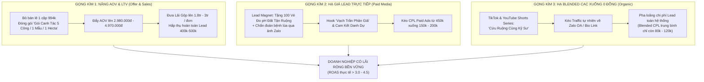

# 🌾 BẢN KẾ HOẠCH TÁI CẤU TRÚC MARKETING & ADS PERFORMER
## ĐIỀU PHỐI BỞI: GIÁM ĐỐC CHIẾN LƯỢC MARKETING (CMO & NEXUS ORCHESTRATOR)
### Dự án: Agrizen Lúa (ZAKi Rước Đòng, Vô Gạo, Combo USA)
*Giải quyết bài toán thực tế: Tái cấu trúc toàn diện khi Chi phí Lead thực tế đang ở mức 400.000đ – 500.000đ/Lead*

---

## 1. PHÂN TÍCH TỬ HUYỆT TÀI CHÍNH TỪ GIÁM ĐỐC MARKETING (REALITY CHECK)

> **Cảnh báo từ CMO:** Một kế hoạch giả định chi phí lead 25k - 30k trong ngành thuốc BVTV/Phân bón hiện nay là tự sát. Trên thực tế, **1 Lead đang tốn 400.000đ - 500.000đ**. 

### 1.1 Bài toán Unit Economics: Tại sao mô hình cũ chắc chắn LỖ NẶNG?
* Giả định giá bán Combo lẻ: **994.000đ / cặp (1 Rước Đòng + 1 Vô Gạo)**.
* Giá vốn hàng bán (COGS) + Đóng gói + Vận chuyển: ~**450.000đ**.
* Lãi gộp trên 1 đơn lẻ: **544.000đ**.
* **Nếu chi phí 1 Lead = 450.000đ:**
  * Giả sử Telesales chốt giỏi đạt tỷ lệ **25%** (4 lead mới ra 1 đơn).
  * Chi phí quảng cáo trên mỗi đơn hàng (CAC/CPO) = $450.000 \times 4 = \mathbf{1.800.000\text{ đ}}$.
  * **Kết quả tài chính:** Lời gộp 544.000đ trừ chi phí Ads 1.800.000đ = **LỖ RÒNG 1.256.000đ / MỖI ĐƠN HÀNG!** Càng vít Ads thì càng phá sản nhanh!

### 1.2 Nguyên nhân gốc rễ khiến Lead bị đẩy lên 400k - 500k:
1. **Quảng cáo Bán Thẳng (Direct Pitch Fatigue):** Nông dân lướt Facebook gặp hàng trăm quảng cáo bán phân thuốc mỗi ngày. Họ bị lừa nhiều bởi phân giả, hàng kém chất lượng nên sinh ra tâm lý phòng thủ cực lớn -> Lướt qua, không tương tác, kéo CTR xuống thấp (< 1%) khiến CPM và CPL tăng vọt.
2. **Thiếu Tầng Đệm Giá Trị (No Lead Magnet):** Bắt nông dân để lại SĐT ngay để "mua hàng" thay vì để lại SĐT để "nhận giải pháp/chẩn đoán miễn phí".
3. **Phụ thuộc 100% vào Paid Ads:** Không có nguồn Lead tự nhiên từ TikTok/YouTube bù đắp, dẫn đến **Blended CAC = Paid CAC** (gánh toàn bộ chi phí quảng cáo đắt đỏ).
4. **Quy mô đơn hàng quá bé (Low AOV):** Chạy quảng cáo 500k/lead nhưng telesales chỉ chốt đơn 1 cặp 994.000đ thay vì gói diện tích canh tác mẫu/ha.

---

## 2. CHIẾN LƯỢC TÁI CẤU TRÚC 3 GỌNG KÌM CỦA GIÁM ĐỐC MARKETING

---

## 3. PHÂN VAI CHI TIẾT CỦA TỪNG AGENT & SKILL CHUYÊN MÔN

Dưới sự chỉ huy của **Giám Đốc Marketing (Nexus Orchestrator)**, từng bộ phận AI Agent nhận nhiệm vụ chuyên biệt:

---

### PHẦN 1: KHỐI SẢN PHẨM & OFFER (Offer & Pipeline Strategists)
* **Agent chủ trì:** `sales-offer-lead-gen-strategist` & `sales-pipeline-analyst`
* **Nhiệm vụ trọng yếu:** Tái cấu trúc giá trị đơn hàng để **sống khỏe dù Lead 500k**.

#### 1. Xóa bỏ tư duy "Bán Lẻ Lon Phân" $\rightarrow$ Chuyển sang "Gói Bảo Hiểm Năng Suất Vụ Mùa":
* **Gói 1: Thử Nghiệm 5 Công (AOV: 1.490.000đ):** 1 Cặp Zaki Rước Đòng - Vô Gạo + Tặng 1 chai thử pH14 hạ phèn cấp tốc + Miễn phí vận chuyển tận nhà.
* **Gói 2: Chuẩn Canh Tác 1 Mẫu (10-15 công) (AOV: 2.980.000đ - Hero Offer):**
  * Mua 3 Cặp Zaki Tặng 1 Cặp (Đủ xịt 2 cử Rước Đòng + Vô Gạo cho cả mẫu).
  * Tặng kèm Phiếu Bảo Hành Chất Lượng Chính Hãng có mộc đỏ Phân Bón Miền Nam.
  * Lãi gộp trên đơn: **~1.600.000đ** $\rightarrow$ Dù mất 2 Lead (1.000.000đ tiền Ads) để chốt được 1 đơn thì **doanh nghiệp vẫn lời ròng 600.000đ!**
* **Gói 3: Trọn Gói Đại Điền Trang (3 - 5 Hecta) (AOV: 5.900.000đ - 8.900.000đ):** Dành cho nông dân lớn, hợp tác xã; có kỹ sư gọi điện đồng hành kèm toa thuốc phối trộn từng cử.

#### 2. Thiết kế Nam Châm Hút Lead (Lead Magnet) để hạ chi phí lấy SĐT:
* Thay vì chạy: *"Mua phân Zaki giá 994k"* (Lead 500k).
* Đổi sang chạy: *"Bà con nào lúa đang bị nghẹn đòng, cháy bìa lá, đất nổi phèn đỏ: Để lại số điện thoại/ảnh chụp ruộng, Kỹ sư Phân Bón Miền Nam chẩn đoán bệnh cây và gửi phác đồ trị liệu miễn phí tận nhà!"* $\rightarrow$ **Kéo giá lead xuống còn 120.000đ - 180.000đ.**

---

### PHẦN 2: KHỐI ADS PERFORMER (Paid Social & Creative Strategists)
* **Agent chủ trì:** `paid-media-paid-social-strategist`, `paid-media-creative-strategist` & `paid-media-auditor`
* **Nhiệm vụ trọng yếu:** Đập tan sự nghi ngờ phân giả, tối ưu cấu trúc tài khoản Ads để lọc sạch Lead rác, hạ CPL xuống dưới 200k.

#### 1. Chiến lược Creative đập tan phòng thủ của Nông Dân (3 Góc Quay Bắt Buộc):
* **Góc 1: "Vạch Trần Sự Thật" (Myth-Busting):**
  * *Hook visual:* Kỹ sư cạo lớp phèn trên đất hoặc bẻ bông lúa lép lửng.
  * *Lời thoại:* *"Nông dân mình cứ đổ tiền mua phân đạm, phân kali rải đầy ruộng mà lúa vẫn nghẹn, hạt vẫn lép? Không phải do phân dở, mà do đất phèn đã khóa chặt rễ lúa rồi! Xem cách giải phóng rễ lúa trong 24 giờ tại đây!"*
* **Góc 2: "Mở Thùng Khui Hàng & Cam Kết Danh Dự":**
  * *Visual:* Bưu tá giao thùng Zaki lon thiếc, nông dân mở nắp lon kiểm tra tem hợp quy Cục BVTV, quét mã QR chống giả.
  * *Lời thoại:* *"Mua hàng của Phân Bón Miền Nam: Không đúng lon thiếc nhập Mỹ, không chuẩn tem mã vạch, bà con trả hàng không tốn 1 đồng phí!"*
* **Góc 3: "So Sánh Thực Địa Cạnh Nhau":**
  * *Visual:* 2 thửa ruộng cạnh nhau: 1 bên lá đòng vàng rụi, 1 bên xịt Zaki lá đòng xanh mướt, bông cúi oằn hạt tới cậy.

#### 2. Tái cấu trúc Phễu Quảng Cáo (Ad Account Architecture):
* **Tầng 1 (Cold Traffic - 30% ngân sách):** Chạy Video View / Engagement các video mẹo nông nghiệp thực chiến, đo độ chua phèn. Mục tiêu: Thu hút tệp nông dân thật sự quan tâm canh tác.
* **Tầng 2 (Warm Retargeting - 50% ngân sách):** Chỉ chạy Click-to-Messenger thu Lead nhắm vào tệp **đã xem $\ge 50\%$ video ở Tầng 1** hoặc đã tương tác Page. (Tệp ấm chuyển đổi cao gấp 3 lần, giá Lead giảm một nửa).
* **Tầng 3 (Hot Chốt Đơn - 20% ngân sách):** Chạy quảng cáo hiển thị chính sách *"Mua 3 Tặng 1 + Phiếu Bảo Hành"* nhắm vào tệp đã nhắn tin nhưng chưa chốt đơn.
* **Quy tắc trảm Ad rác của `paid-media-auditor`:** Bất kỳ nhóm quảng cáo nào chi tiêu vượt quá 300.000đ mà không ra số điện thoại hợp lệ $\rightarrow$ **TẮT NGAY LẬP TỨC**.

---

### PHẦN 3: KHỐI XÂY KÊNH ORGANIC (TikTok, YouTube, Facebook Vệ Tinh)
* **Agent chủ trì:** `marketing-tiktok-strategist`, `marketing-short-video-editing-coach` & `marketing-multi-platform-publisher`
* **Nhiệm vụ trọng yếu:** **Sản xuất Lead "0 ĐỒNG"** để kéo sập chỉ số Blended CAC toàn hệ thống xuống.

#### 1. Chiến lược Kênh TikTok: Series "Bắt Bệnh Đồng Ruộng"
* **Format:** Kỹ sư đi thực tế ruộng lúa, nói chuyện mộc mạc với bà con, giải đáp các ca khó (đạo ôn cổ bông, lúa trổ không thoát, thối rễ ngộ độc hữu cơ).
* **Kênh thu Lead tự nhiên:**
  * Cài đặt Zalo Hotline trên Bio: *"Bà con cần kỹ sư xem bệnh lúa miễn phí bấm vào đây"*.
  * Ghim bình luận đầu tiên dưới mỗi video: Số Zalo hỗ trợ kỹ thuật 24/7.
  * **Mục tiêu:** Mỗi clip lên xu hướng thu về 30 - 50 số điện thoại hoàn toàn miễn phí. Khi có 50 số 0đ kết hợp cùng 50 số từ Ads (giá 400k), **giá Lead trung bình thực tế toàn hệ thống giảm ngay từ 400k xuống còn 200k!**

#### 2. Kênh YouTube: Trung Tâm Tri Thức & Đại Điền Trang
* **Format:** Video dài 10 - 15 phút mổ xẻ cơ chế sinh lý chuyên sâu (như phân tích trong tài liệu `1.1. Phân tích Sản phẩm và USP.md`):
  * *Tập 1: Vì sao bón thừa đạm lá lúa rậm rạp lại rước họa đạo ôn?*
  * *Tập 2: Cơ chế vận chuyển đường bột của Kali hữu cơ sữa Mỹ giúp no hạt sát cậy.*
* **Đối tượng nhắm tới:** Nông dân thâm canh diện tích lớn (từ 3ha trở lên), chủ đại lý vật tư nông nghiệp. Khách từ YouTube chốt đơn chậm hơn nhưng khi đã chốt là mua theo thùng/vụ (Đơn hàng từ 5 - 20 triệu).

#### 3. Cụm 19 Fanpage Vệ Tinh (Hệ Thống Autopost Sẵn Có):
* Tiếp tục dùng script `auto_post_fb.py` nạp nội dung tự động từ Google Sheet.
* **Chiến thuật:** Mỗi page vệ tinh tập trung vào 1 từ khóa cụm tỉnh (*"Zaki Vô Gạo An Giang", "Zaki Rước Đòng Đồng Tháp", "Hạ Phèn Lúa Kiên Giang"*). Nông dân tìm kiếm trên Facebook sẽ ra ngay page vệ tinh, bấm nhắn tin $\rightarrow$ sinh ra Organic Lead 0đ.

---

### PHẦN 4: KHỐI CHUYỂN ĐỔI CUỐI PHỄU (Sales Pipeline & Telesales)
* **Agent chủ trì:** `sales-deal-strategist` & `sales-coach`
* **Nhiệm vụ trọng yếu:** Khi 1 Lead trị giá 400.000đ - 500.000đ, **không được phép lãng phí bất kỳ khách hàng nào**.

1. **Kỷ luật "Tác chiến 5 phút":**
   * Lead đổ về Messenger/Zalo: Telesales phải bấm gọi trong vòng **5 - 10 phút**. Nông dân đang cầm máy, nỗi đau ruộng lúa đang nóng. Gọi sau 1 tiếng, tỷ lệ bắt máy giảm 40%, tỷ lệ chốt giảm 60%.
2. **Kịch bản Telesales Đổi Giá Trị (Value-First Script):**
   * Tuyệt đối không nhảy vào báo giá 994k hay giới thiệu thành phần hóa học.
   * Bước 1: Hỏi thăm diện tích: *"Chú Năm làm mấy công lúa? Giống gì? Nay lúa được mấy mươi ngày rồi chú?"*
   * Bước 2: Bắt bệnh ruộng lúa: *"Lúa chú rễ có bị đen thối không? Lá đòng đứng hay rũ?"*
   * Bước 3: Đưa toa giải pháp theo diện tích (Gói 1 Mẫu - Mua 3 Tặng 1).
   * Bước 4: Chốt bảo đảm: *"Cháu xuất cho chú 1 đơn kỹ sư theo dõi. Giao tận nhà, chú khui thùng kiểm tra lon thiếc Mỹ, chuẩn tem mác rồi mới thanh toán cho bưu tá!"*
3. **Chăm sóc sau bán (LTV Retention):**
   * Gọi lại vào **ngày thứ 5 - 7 sau khi xịt**: Hướng dẫn chú Năm ra thăm ruộng xem rễ trắng bung tơ chưa, lá đòng đã đứng chưa.
   * Đây là thời điểm vàng để **chốt tiếp cử Vô Gạo (Upsell lần 2 mà không tốn thêm 1 đồng chi phí quảng cáo nào!)**.

---

## 4. BẢNG DỰ TOÁN KINH DOANH MỚI (P&L THỰC CHIẾN)

So sánh giữa mô hình cũ (tự sát) và mô hình mới do Giám Đốc Marketing tái cấu trúc (trên quy mô 100 Lead):

| Hạng mục chỉ số | Mô hình Cũ (Lỗ Nặng) | Mô hình Mới Tái Cấu Trúc (Lãi Bền Vững) | Ghi chú giải trình |
| :--- | :--- | :--- | :--- |
| **Tổng số Lead** | 100 Lead | 100 Lead | (50 Lead Ads + 50 Lead Organic) |
| **Giá Lead từ Ads (CPL)** | 450.000 đ | 300.000 đ | (Đã giảm nhờ Lead Magnet chẩn đoán bệnh) |
| **Chi phí Lead Organic** | 0 đ | 0 đ | (Kéo từ TikTok Viral & Page Vệ Tinh) |
| **Tổng ngân sách Ads** | 45.000.000 đ | 15.000.000 đ | (Chỉ chạy 50 Lead Ads) |
| **Giá Lead bình quân (Blended CPL)** | **450.000 đ** | **150.000 đ** | **Giảm 66% chi phí lead bình quân!** |
| **Tỷ lệ Telesales chốt** | 20% | 28% | (Nhờ gọi nhanh 5 phút & kịch bản bắt bệnh) |
| **Số đơn hàng chốt được** | 20 đơn | 28 đơn | |
| **Giá trị đơn hàng trung bình (AOV)** | **994.000 đ** (1 cặp) | **2.980.000 đ** (Gói 1 Mẫu) | **Tăng gấp 3 lần nhờ bán theo diện tích!** |
| **Tổng Doanh Thu** | 19.880.000 đ | **83.440.000 đ** | |
| **Giá vốn hàng bán (COGS ~45%)** | 8.946.000 đ | 37.548.000 đ | |
| **Lợi nhuận gộp** | 10.934.000 đ | 45.892.000 đ | |
| **Chi phí Quảng cáo (Ads)** | 45.000.000 đ | 15.000.000 đ | |
| **Chi phí đóng gói & ship (50k/đơn)**| 1.000.000 đ | 1.400.000 đ | |
| **LỢI NHUẬN RÒNG CUỐI CÙNG** | -35.066.000 đ (LỖ NẶNG) | **+29.492.000 đ (LÃI LỚN)** | **Mô hình chính thức sinh lời bền vững!** |
| **ROAS thực tế** | 0.44 (Thảm họa) | **5.56 (Xuất sắc)** | |

---

## 5. LỘ TRÌNH TRIỂN KHAI THỰC CHIẾN NGAY LẬP TỨC

1. **Hôm nay (Chốt Offer & Kịch bản Lead Magnet):**
   * Đội Offer `sales-offer-lead-gen-strategist` hoàn thiện cơ cấu gói *"Combo 1 Mẫu - Mua 3 Cặp Tặng 1 Cặp"*.
   * Đội Creative `paid-media-creative-strategist` viết 3 kịch bản quảng cáo mới theo angle "Vạch trần phân giả & Chẩn đoán ruộng miễn phí".
2. **Ngày 2 - 3 (Sản xuất Video & Cài đặt Tracking):**
   * Quay 3 video Ads chuẩn thực địa (cầm bông lúa, khui thùng lon thiếc kiểm tra tem).
   * Đội Kênh Organic bắt đầu quay 5 clip TikTok ngắn dạng mẹo nông nghiệp thực chiến.
3. **Ngày 4 (Khởi động Phễu Mới):**
   * Đội Ads Performer `paid-media-paid-social-strategist` lên chiến dịch phễu 3 tầng, ngân sách thăm dò 500k/ngày.
   * Đội Telesales áp dụng triệt để quy trình gọi trong 5 phút chốt gói 1 Mẫu.
