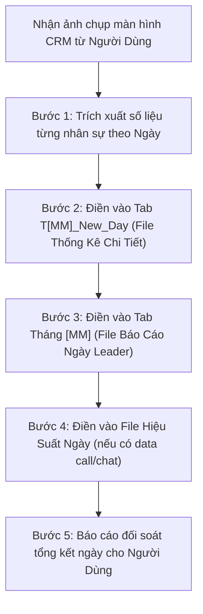

# 📋 QUY TRÌNH CHUẨN (SOP) — SETUP HỆ THỐNG BÁO CÁO & DỮ LIỆU ĐỒNG BỘ THÁNG MỚI
**Dự Án:** ZAKi (Agrizen Lúa) — Team Uyên Nhi  
**Chu Kỳ Áp Dụng:** Đầu mỗi tháng dương lịch (chuẩn bị sẵn sàng trước ngày 01) & Tác nghiệp hàng ngày  
**Tài Khoản Vận Hành:** Google Drive Work Uyên Tôn (`uyenton.soleilfr@gmail.com`)  

---

## I. MỤC TIÊU & TÀI NGUYÊN HỆ THỐNG

### 1. Mục tiêu
Thiết lập đồng bộ trọn bộ 5 hạ tầng dữ liệu và báo cáo của Team Telesales đầu mỗi tháng mới:
1. **10 File Báo Cáo Doanh Thu (BCDT) cá nhân độc lập:** Bảo mật số liệu cá nhân, cấp quyền Writer cho đúng Gmail nhân sự. **Nhân sự tự chịu trách nhiệm nhập số liệu hàng ngày của mình.**
2. **Tab DATA THÁNG MỚI trong file `DATA CHƯA XÓA`:** Tiếp nhận, đối soát và xử lý số trùng, số sai, spam, nhầm số để phục vụ bù data và làm việc với Admin/Leader.
3. **Tab THÁNG MỚI trong file `HIỆU SUẤT NGÀY`:** Theo dõi các chỉ số cuộc gọi thực tế hàng ngày (Thời lượng gọi, Bắt máy, Tin nhắn, Tỷ lệ Chat) đồng bộ từ tổng đài CRM/VBot.
4. **Tab THÁNG MỚI trong file `BÁO CÁO NGÀY Leader`:** Báo cáo tổng thể doanh thu, contact, số đơn, tỉ lệ chốt và tiến độ đạt target tháng/tuần/ngày của toàn đội ngũ.
5. **Tab THÁNG MỚI trong file `LÚA - Bảng Thống Kê Chi Tiết Ngày`:** Thống kê chi tiết từng ngày theo từng nhân sự (Data, Đơn, Doanh thu, TLC, AOV, % Target) đối soát trực tiếp với Leader.

### 2. Danh Sách Các File & Thư Mục Trọng Yếu Trên Google Drive
* **Thư mục mẹ Team Uyên Nhi:** `1EdBY7VgIaPSyFpnTscqOD6DhDNEHBz0E`
* **Thư mục BCDT:** `1kBsJu4W4XC74L4RZwuhIx0_bFypZYd8E` (Chứa các folder `Tháng 10/26`, `Tháng 11/26`...)
* **File Điều Phối Trung Tâm:** `TỔNG HỢP NỘI BỘ` (`1s8r3FC2plOFzh37ZJPRRWmjxA091PZ7rAaho7hR-v0s`), trang tính `03_Tổng Hợp Link`.
* **File Quản Lý Data Chưa Xóa:** `DATA CHƯA XÓA` (`1wJFFILk1BWr-ZYolKO-MrnFgbdYVWrnzFWKh2aERz_Q`).
* **File Thống Kê Cuộc Gọi:** `HIỆU SUẤT NGÀY` (`1It5ldQsvgBf0loQfvuMVwTLLdHl1UWSeTKsyrl_kxDY`).
* **File Báo Cáo Tổng Hợp Leader:** `BÁO CÁO NGÀY Leader` (`1-ogqHY8b1XZiOrphS9X9U9rZXnSobX_uqHxIag9sYao`).
* **File Theo Dõi Chi Tiết Ngày Leader:** `LÚA - Bảng Thống Kê Chi Tiết Ngày` (`1Y2um2R0Iu2T6vOK0sV06XNZ3WHLSoNpO4jym2YS0m70`).

---

## II. DANH MỤC 10 NHÂN SỰ & QUY CHUẨN ĐẶT TÊN

| STT | Tên File Báo Cáo Chuẩn | Họ Và Tên Đầy Đủ (Ô A1 Sheet 1) | Tên Hiển Thị (Hiệu Suất / Bảng Ngày) | Gmail Phân Quyền (Writer) |
| :---: | :--- | :--- | :--- | :--- |
| **1** | `1. MINH NHIỀU - BÁO CÁO DOANH THU` | `PHẠM MINH NHIỀU` | `Phạm Minh Nhiều` / `Minh Nhiều` | `minhnhieu17nhc@gmail.com` |
| **2** | `2. ĐOAN TRINH - BÁO CÁO DOANH THU` | `NGUYỄN HUỲNH ĐOAN TRINH` | `Nguyễn Huỳnh Đoan Trinh` / `Trinh` | `lev9385@gmail.com` |
| **3** | `3. MINH HẢI - BÁO CÁO DOANH THU` | `NGUYỄN MINH HẢI` | `Nguyễn Minh Hải` / `Hải` | `nguyenminhhai1112004@gmail.com` |
| **4** | `4. KIM NGỌC - BÁO CÁO DOANH THU` | `ĐỖ THỊ KIM NGỌC` | `Đỗ Thị Kim Ngoc` / `Ngọc` | `ngocdothikim1@gmail.com` |
| **5** | `5.XUÂN QUÍ- BÁO CÁO DOANH THU` | `TRẦN XUÂN QUÍ` | `Trần Xuân Quí` / `Quí` | `tranxuanquypqkg@gmail.com` |
| **6** | `6. LÊ TÂN- BÁO CÁO DOANH THU` | `NGÔ LÊ TÂN` | `Ngô Lê Tân` / `Lê Tân` | `letan230415@gmail.com` |
| **7** | `7. Hoàng - BÁO CÁO DOANH THU` | `NGUYỄN VĂN HOÀNG` | `Nguyễn Văn Hoàng` / `Hoàng` | `dauhoang591@gmail.com` |
| **8** | `8. TUYẾT MAI - BÁO CÁO DOANH THU` | `VÕ THỊ TUYẾT MAI` | `Võ Thị Tuyết Mai` / `Mai ` | `mn8728936@gmail.com` |
| **9** | `9. KHÁNH HUYỀN - BÁO CÁO DOANH THU` | `TRẦN ĐÌNH KHÁNH HUYỀN` | `Trần Đinh Khánh Huyền` / `Huyền` | `tranhuyenn2806@gmail.com` |
| **10** | `10. HẠ QUYÊN - BÁO CÁO DOANH THU` | `TRẦN THỊ HẠ QUYÊN` | `Trần Thị Hạ Quyên` / `Quyên` | `tranthihaquyen041904@gmail.com` |
| *Lead* | — | `UYÊN NHI` | `Nhi` | `trungduong.magneto@gmail.com` |

---

## III. QUY TRÌNH PHẦN 1: BÁO CÁO DOANH THU CÁ NHÂN (BCDT)

### BƯỚC 1: Tạo Folder Tháng Mới Trong Thư Mục `BCDT`
1. Truy cập thư mục `BCDT` (ID: `1kBsJu4W4XC74L4RZwuhIx0_bFypZYd8E`).
2. Tạo thư mục mới: **`Tháng [MM]/26`** (Ví dụ: `Tháng 11/26`, `Tháng 12/26`...).

### BƯỚC 2: Chuẩn Bị File Mẫu Chuẩn Của Tháng Mới
1. Lấy file mẫu từ tháng trước (Ví dụ file của Minh Nhiều).
2. Đổi tên 2 trang tính:
   * **Sheet 1:** `Báo cáo ngày T[MM]/26`. Cột Ngày chạy từ `01/[MM]/2026` đến ngày cuối tháng (`30` hoặc `31`).
   * **Sheet 2:** `Báo cáo doanh thu T[MM]/2026`.
   * Xóa sạch các số liệu ngày cũ (giữ nguyên toàn bộ tiêu đề, công thức tính tổng và tỷ lệ).
3. Đặt file mẫu này vào thư mục tháng mới với tên: `1. MINH NHIỀU - BÁO CÁO DOANH THU`.

### BƯỚC 3: Nhân Bản 10 File & Cập Nhật Tên Cá Nhân (Ô A1)
1. Dùng lệnh `gdrive mutate cp` nhân bản từ file mẫu ra 9 file còn lại vào đúng thư mục tháng mới:
   ```bash
   gdrive mutate cp [TEMPLATE_ID] "[TÊN_FILE_CHUẨN]" --parent [FOLDER_ID_THÁNG_MỚI]
   ```
2. Cập nhật ô **A1** của Sheet 1 (`Báo cáo ngày T[MM]/26`) cho từng file:
   * Cú pháp chuẩn: `BÁO CÁO NGÀY - [HỌ VÀ TÊN ĐẦY ĐỦ CÓ DẤU]`.

### BƯỚC 4: Phân Quyền Truy Cập (Permissions)
Mỗi file báo cáo cá nhân bắt buộc chỉ có đúng 3 thành phần truy cập:
1. **Admin / Owner:** `uyenton.soleilfr@gmail.com`.
2. **Quản lý (Editor / Writer):** `trungduong.magneto@gmail.com`.
3. **Nhân sự phụ trách (Editor / Writer):** Đúng địa chỉ Gmail của nhân sự đó theo Bảng mục II:
   ```bash
   gdrive mutate share [FILE_ID] --email [EMAIL_NHAN_SU] --role writer
   ```

### BƯỚC 5: Cập Nhật Smart Chips Vào `TỔNG HỢP NỘI BỘ`
1. Mở file `TỔNG HỢP NỘI BỘ` (`1s8r3FC2plOFzh37ZJPRRWmjxA091PZ7rAaho7hR-v0s`), sheet `03_Tổng Hợp Link`.
2. Tại **BẢNG 2**, tạo/kiểm tra tiêu đề cột tháng mới (Dòng 21).
3. Chèn Smart Chip chuẩn: Đưa ký tự giữ chỗ `@` vào `userEnteredValue.stringValue`, kèm mảng `chipRuns` với `startIndex: 0` trỏ đến URI của file.

---

## IV. QUY TRÌNH PHẦN 2: THIẾT LẬP TAB `DATA THÁNG [MM]` (FILE DATA CHƯA XÓA)

* **File:** `DATA CHƯA XÓA ` (ID: `1wJFFILk1BWr-ZYolKO-MrnFgbdYVWrnzFWKh2aERz_Q`).
* **Vị trí tab mới:** Luôn nằm ở vị trí đầu tiên bên trái (`insertSheetIndex: 0`).

### Các Bước Thực Hiện:
1. **Duplicate Sheet:** Nhân bản tab tháng trước (`sourceSheetId` của tháng trước) sang tab mới tên **`DATA THÁNG [MM]`** ở vị trí index `0`.
2. **Cập nhật tiêu đề ô A1:** Sửa thành `DATA THÁNG [MM] - TEAM LÚA CHƯA XOÁ` (Nền vàng, Arial 21pt in đậm).
3. **Xóa dữ liệu cũ:** Gọi API `spreadsheets.values.clear` cho dải ô `A3:Z`. *Tuyệt đối không xóa dòng để giữ nguyên vẹn định dạng, độ rộng cột và dropdown validation.*
4. **Đồng bộ Dropdown SALE (Cột C, dòng 3-1015):** Thiết lập `condition: ONE_OF_LIST` với danh sách đầy đủ:
   `['Nhi', 'Minh Nhiều', 'Trinh', 'Hải', 'Ngọc', 'Quí', 'Lê Tân', 'Tân', 'Mai ', 'Quyên', 'Huyền', 'Hoàng']`.
5. **Kiểm tra các dropdown khác:** Cột E (Tình trạng), Cột G (Leader check), Cột H (Admin check).

---

## V. QUY TRÌNH PHẦN 3: THIẾT LẬP TAB `Tháng [MM]/[YYYY]` (FILE HIỆU SUẤT NGÀY)

* **File:** `HIỆU SUẤT NGÀY` (ID: `1It5ldQsvgBf0loQfvuMVwTLLdHl1UWSeTKsyrl_kxDY`).
* **Vị trí tab mới:** Luôn nằm ở vị trí đầu tiên bên trái (`insertSheetIndex: 0`).

### Các Bước Thực Hiện:
1. **Duplicate Sheet:** Nhân bản tab tháng trước (Ví dụ `Tháng 10/2026`) thành **`Tháng [MM]/[YYYY]`** (Ví dụ: `Tháng 11/2026`).
2. **Cập nhật Banner Dòng 1:** `THỐNG KÊ HIỆU SUẤT TEAM NEW LÚA - THÁNG [MM]/[YYYY]`.
3. **SỬA CÔNG THỨC NGÀY BẮT ĐẦU Ô G3:**
   * Nhập công thức: **`=date([YYYY];[MM];1)`** (Ví dụ: `=date(2026;11;1)`).
   * Toàn bộ 30 ngày trong bảng sẽ tự động đồng bộ hiển thị chuẩn: `1/[MM]` đến `30/[MM]`.
4. **Xử lý số ngày trong tháng (30 ngày vs 31 ngày):**
   * Nếu tháng có **30 ngày** (Tháng 4, 6, 9, 11): Ô **DW3** (ngày 31 cũ) **phải xóa trống** để không bị nhảy sang ngày `1` của tháng kế tiếp.
   * Nếu tháng có **31 ngày**: Đảm bảo ô **DW3** có công thức `=DS3+1`.
5. **Cập nhật KPI Cột C:F:** Rà soát và cập nhật chỉ tiêu mới (TL gọi, Bắt máy, TN, CHAT) cho từng nhân sự.
6. **Xóa dữ liệu cũ:** Xóa toàn bộ số liệu vùng **G5:DZ14**, giữ nguyên công thức tính tổng kết tại **EA5:EG14**.

---

## VI. QUY TRÌNH PHẦN 4: THIẾT LẬP TAB `Tháng [MM]` (FILE BÁO CÁO NGÀY LEADER)

* **File:** `BÁO CÁO NGÀY Leader` (ID: `1-ogqHY8b1XZiOrphS9X9U9rZXnSobX_uqHxIag9sYao`).
* **Vị trí tab mới:** Đặt tại vị trí index `2`, nằm ngay cạnh tab tháng trước.

### Các Bước Thực Hiện:
1. **Duplicate Sheet:** Nhân bản tab `'Tháng 10'` sang tab mới tên **`'Tháng 11'`** tại index 2.
2. **Cập nhật tiêu đề ô B2:** Sửa thành `BÁO CÁO TEAM LÚA THÁNG [MM]/[YYYY]` (Ví dụ: `BÁO CÁO TEAM LÚA THÁNG 11/2026`).
3. **Sửa công thức ngày tại ô C7:** Sửa thành **`=date([YYYY];[MM];1)`** (Ví dụ: `=date(2026;11;1)`). Toàn bộ cột ngày C8 đến C36 sẽ tự động nhảy theo đúng ngày của tháng mới.
4. **Xóa sạch dữ liệu cũ:** Gọi API clear hoặc chọn xóa vùng **`D7:F37`** (giữ nguyên toàn bộ công thức tại Cột G, H, I).
5. **Xử lý ngày 31 cho tháng 30 ngày:**
   * Tại dòng 37 (STT 31), **xóa trống ô C37** (xóa công thức `=C36+1`) để tránh hiển thị ngày `1` của tháng sau.
6. **Kiểm tra công thức:** Xác nhận dòng 6 tính tổng `SUM(D7:D37)`, `SUM(E7:E37)`, `SUM(F7:F37)` và các tỷ lệ hoạt động chính xác.

---

## VII. QUY TRÌNH PHẦN 5: THIẾT LẬP TAB `T[MM]_New_Day` (FILE THEO DÕI NGÀY LEADER)

* **File:** `LÚA - Bảng Thống Kê Chi Tiết Ngày` (ID: `1Y2um2R0Iu2T6vOK0sV06XNZ3WHLSoNpO4jym2YS0m70`).
* **Vị trí tab mới:** Luôn nằm ở vị trí đầu tiên bên trái (`insertSheetIndex: 0`).

### Các Bước Thực Hiện:
1. **Duplicate Sheet:** Nhân bản tab `T10_New_Day` sang tab mới tên **`T11_New_Day`** tại vị trí đầu tiên (`insertSheetIndex: 0`).
2. **Sửa ô ngày bắt đầu B3:** Nhập **`=date(2026;11;1)`**. Toàn bộ 30 khối ngày (`B20`, `B37`... đến `B496`) sẽ tự động chuyển thành ngày `01/11/26` đến `30/11/26`.
3. **Đồng bộ chuẩn 10 tên nhân sự cho toàn bộ 30 ngày:**
   * Đảm bảo từ Ngày 1 đến Ngày 30, Cột C và Cột N đều hiển thị chuẩn 10 họ tên thật (tránh lỗi hiển thị `Sale 1 - Sale 9`).
4. **Đồng bộ bảng Target tham chiếu (Cột N:T):**
   * Đảm bảo mức Data, TLC min, TLC chuẩn, AOV và Target tháng khớp với định mức giao việc của team.
5. **Xóa sạch dữ liệu raw cũ cả 30 ngày:**
   * Xóa trắng các ô Cột D, E, F (`Data/Mess`, `Đơn chốt`, `Doanh thu`) của 10 nhân sự trong toàn bộ 30 khối ngày. Bảo lưu 100% công thức tại Cột G đến L và dòng tổng ngày.

---

## VIII. CHECKLIST TỔNG HỢP KIỂM THỬ TRƯỚC KHI BÀN GIAO (QA)

### 1. 10 File BCDT Cá Nhân
- [ ] Folder tháng mới nằm đúng trong `Team Uyên Nhi > BCDT`.
- [ ] Đủ 10 file tương ứng 10 nhân sự, tên file chuẩn 100%.
- [ ] Ô A1 của Sheet 1 trên từng file mang đúng họ tên đầy đủ có dấu của nhân sự.
- [ ] Ngày tháng Sheet 1 chạy đúng từ 01 đến ngày cuối của tháng mới.
- [ ] Phân quyền Writer đúng email nhân sự và Leader `trungduong.magneto@gmail.com`.
- [ ] File `TỔNG HỢP NỘI BỘ` hiển thị đủ 10 Smart Chip Google Sheets.

### 2. File DATA CHƯA XÓA
- [ ] Tab `DATA THÁNG [MM]` nằm ở vị trí đầu tiên bên trái (index 0).
- [ ] Ô A1 hiển thị chuẩn: `DATA THÁNG [MM] - TEAM LÚA CHƯA XOÁ`.
- [ ] Đủ 9 cột tiêu đề chuẩn, dòng 3 trở đi đã xóa sạch dữ liệu cũ.
- [ ] Dropdown SALE đủ 10 nhân sự Telesales + Lead Nhi.
- [ ] Dropdown các cột Tình trạng, Leader check, Admin check hoạt động chuẩn.

### 3. File HIỆU SUẤT NGÀY
- [ ] Tab `Tháng [MM]/[YYYY]` nằm ở vị trí đầu tiên bên trái (index 0).
- [ ] Tiêu đề banner dòng 1 đúng tháng năm mới.
- [ ] **Ô G3 mang đúng công thức `=date([YYYY];[MM];1)`**, các ngày từ G3 đến DS3 hiển thị đúng tháng mới.
- [ ] **Xử lý chuẩn số ngày:** Tháng 30 ngày thì ô DW3 (ngày 31) đã được xóa trống.
- [ ] KPI cột C:F đã cập nhật theo đúng chỉ tiêu tháng mới.
- [ ] Vùng nhập liệu G5:DZ14 đã xóa dữ liệu cũ.
- [ ] Các công thức SUMIF và chia 26 ngày tại EA5:EG14 hoạt động chính xác.

### 4. File BÁO CÁO NGÀY Leader
- [ ] Tab `Tháng [MM]` được tạo tại index 2, kế bên tab tháng trước.
- [ ] Banner dòng 2: `BÁO CÁO TEAM LÚA THÁNG [MM]/[YYYY]`.
- [ ] **Ô C7 mang đúng công thức `=date([YYYY];[MM];1)`**, ngày chạy từ 01 đến 30.
- [ ] Dòng 37 (ngày 31) đã xóa trống ngày ở ô C37.
- [ ] Dải ô D7:F37 đã xóa sạch số liệu cũ, công thức tổng và tỷ lệ dòng 6 hoạt động tốt.

### 5. File LÚA - Bảng Thống Kê Chi Tiết Ngày
- [ ] Tab `T[MM]_New_Day` được tạo tại index 0.
- [ ] **Ô B3 mang đúng công thức `=date([YYYY];[MM];1)`**, 30 khối ngày hiển thị từ 01 đến 30.
- [ ] Cả 30 ngày đều hiển thị đủ 10 họ tên nhân sự chuẩn (không còn chữ `Sale 1 - Sale 9`).
- [ ] Cột D, E, F đã xóa sạch số liệu cũ cho cả 30 ngày.
- [ ] Toàn bộ công thức tính TLC, AOV, % Data, % Target và dòng tổng ngày hoạt động chính xác.

---

## IX. QUY CHUẨN TÁC NGHIỆP HÀNG NGÀY: NHẬP SỐ LIỆU TỪ ẢNH CHỤP CRM

> [!IMPORTANT]
> **Phân định trách nhiệm tuyệt đối:**
> * **10 File BCDT cá nhân:** Nhân sự tự chịu trách nhiệm nhập số liệu chi tiết đơn hàng của mình. AI/Leader **KHÔNG can thiệp** vào các file cá nhân này.
> * **Nhiệm vụ của AI khi nhận ảnh chụp CRM hàng ngày:** Chỉ nhập đồng bộ vào **3 file quản lý tập trung**:
>   1. `LÚA - Bảng Thống Kê Chi Tiết Ngày` (Tab `T[MM]_New_Day`)
>   2. `BÁO CÁO NGÀY Leader` (Tab `Tháng [MM]`)
>   3. `HIỆU SUẤT NGÀY` (Tab `Tháng [MM]/[YYYY]` — nếu ảnh CRM có dữ liệu cuộc gọi/chat)

### Quy Trình Nhập Dữ Liệu 3 Bước:


#### 1. Tại File `LÚA - Bảng Thống Kê Chi Tiết Ngày` (Tab `T[MM]_New_Day`):
* Định vị đúng khối ngày (Ngày 1: dòng 6-15, Ngày 2: dòng 23-32... Ngày `N`: `start_row + 3` đến `start_row + 12`).
* Điền số liệu của từng bạn vào 3 cột:
  * **Cột D (`Data/Mess`):** Số lượng contact / tin nhắn được chia.
  * **Cột E (`Đơn chốt`):** Số đơn hàng chốt thành công.
  * **Cột F (`Doanh thu`):** Doanh số thực đạt (nhập số nguyên, Google Sheets sẽ tự định dạng tiền tệ).
* Để các cột G, H, I, J, K, L tự động tính tỷ lệ chuyển đổi (`TLC`), `AOV` và `% Target`.

#### 2. Tại File `BÁO CÁO NGÀY Leader` (Tab `Tháng [MM]`):
* Định vị dòng của ngày tương ứng (Ngày 1: dòng 7, Ngày 2: dòng 8... Ngày `N`: dòng `N + 6`).
* Điền số liệu tổng của toàn team vào 3 cột:
  * **Cột D (`CONTACT`):** Tổng data/contact của cả team trong ngày.
  * **Cột E (`ĐƠN CHỐT`):** Tổng số đơn chốt cả team trong ngày.
  * **Cột F (`TỔNG DOANH THU`):** Tổng doanh thu cả team trong ngày.
* Dòng 6 (Tổng kết tháng) và khung Target tuần/ngày sẽ tự động cập nhật tiến độ đạt mục tiêu.

#### 3. Tại File `HIỆU SUẤT NGÀY` (Tab `Tháng [MM]/[YYYY]`):
* Nếu ảnh chụp CRM có đính kèm bảng chỉ số cuộc gọi VBot / CRM:
  * Tìm đúng cụm 4 cột của ngày đó (Ngày 1: Cột G:J, Ngày 2: Cột K:N...).
  * Điền theo hàng của 10 nhân sự:
    * `TL gọi`: Thời lượng gọi (phút).
    * `Bắt máy`: Số cuộc khách bắt máy.
    * `TN`: Số tin nhắn tương tác.
    * `CHAT`: Tỷ lệ chuyển đổi chat (%).

#### 4. Tự Động Đối Soát Đơn & Doanh Thu (CRM vs Báo Cáo Cá Nhân):
* **Cơ chế kích hoạt:** Ngay sau khi nhập xong dữ liệu CRM vào 3 file, AI tự động chạy lệnh đối soát:
  ```powershell
  python "G:\My Drive\Soleil&co By UyenNhi\10-19 Dự Án Đang Chạy\17. AgrizenLua\03-Code\check_daily_submission.py" --day [NGÀY]
  ```
* **Nội dung đối soát:** So sánh trực tiếp Đơn chốt và Doanh thu của từng bạn Telesales:
  * 🎯 **Khớp 100%:** Đơn và Doanh thu trùng khớp hoàn toàn giữa CRM và BCDT cá nhân.
  * ⚠️ **Lệch số liệu (Cần care đơn):** Báo chi tiết bạn nào lệch đơn (thừa/thiếu bao nhiêu đơn) hoặc lệch doanh thu (thừa/thiếu bao nhiêu tiền).
  * ❌ **Chưa nộp:** Báo các bạn chưa điền kèm số liệu CRM đang ghi nhận.
* **Kênh trả kết quả:** Xuất bảng đối soát trực tiếp trong chat và bắn thông báo qua Telegram của Uyên Nhi (`Report_zaki_bot`).

#### 5. Tự Động Báo Cáo Tình Hình Giao Hàng & Đơn Hàng Lúc 13:00 Hàng Ngày:
* **Cơ chế kích hoạt:** Tự động đúng **13:00 PM** mỗi ngày (Sidecar Automation: `ZAKi Delivery & Order Checker (1:00 PM)`).
  ```powershell
  python "G:\My Drive\Soleil&co By UyenNhi\10-19 Dự Án Đang Chạy\17. AgrizenLua\03-Code\check_delivery_status.py"
  ```
* **Nội dung kiểm tra:** Quét sheet `Báo cáo doanh thu T[MM]/[YYYY]` của 10 nhân sự:
  * Tổng đơn tính trong tháng & Tổng doanh số lên đơn.
  * Số đơn & Doanh số giao thành công (`Thành công`).
  * Số đơn & Doanh số chưa thành công (`Đang giao` / `Chờ xử lý`).
  * Số đơn & Doanh số hủy / hoàn (`Bom/Hoàn` / `Hủy`).
  * Tỷ lệ Doanh số Thực thu / Lên đơn (%).
  * ⚠️ **Cảnh báo nhân sự chưa cập nhật:** Liệt kê các bạn chưa nhập đơn vào bảng chi tiết hoặc có đơn nhưng quên điền trạng thái giao hàng để Uyên Nhi đôn đốc.
* **Kênh gửi:** Telegram cá nhân Uyên Nhi qua bot `@Report_zaki_bot`.


